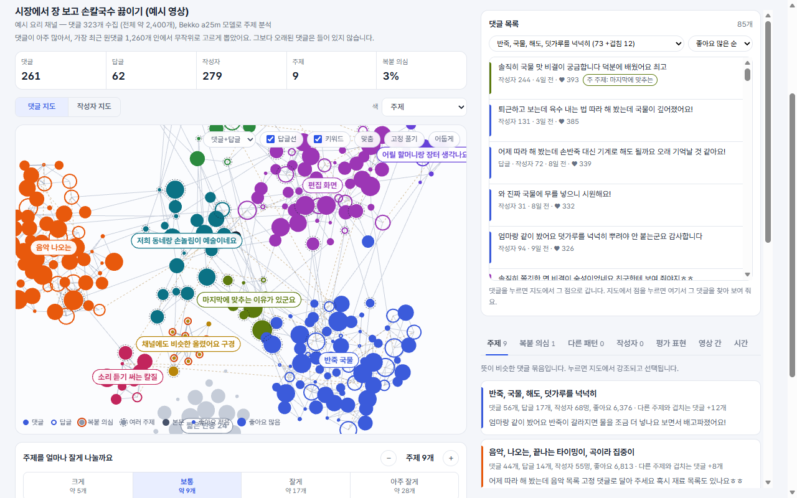
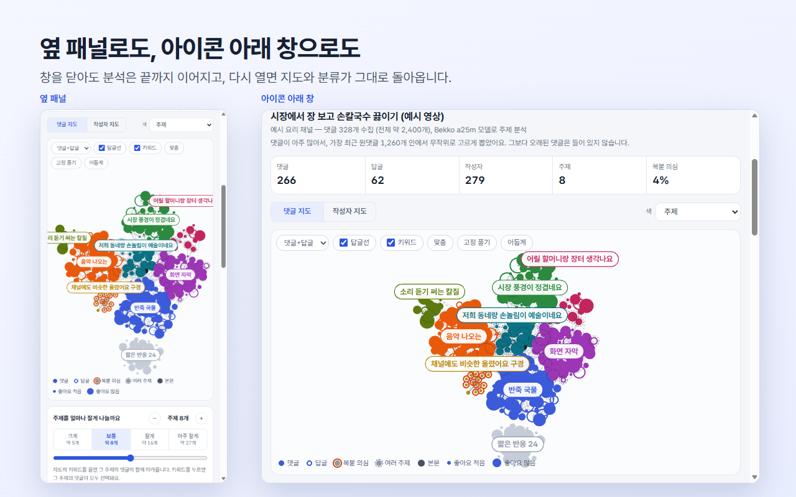
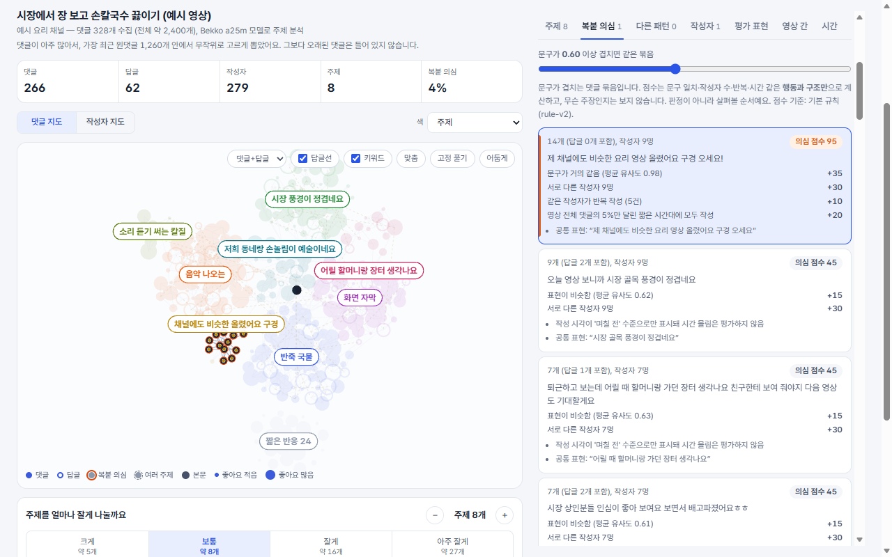

# Web Visualizer

[한국어](README.md) · **English** · [日本語](README.ja.md)

A browser extension that analyzes the comments of a YouTube video **on your device** and shows them as a **topic map** where similar comments sit together.
It surfaces **behavioral signals** such as near-identical wording from many accounts, with the evidence behind each score, so you can tell them apart from natural reactions.



- **Nothing is stored**: comments and results live in memory only. They are gone when you close the video tab or the tab moves to another video or site.
- **Nothing leaves your device**: all computation runs in the browser (GPU or CPU). Only public model files are downloaded, once.
- **No verdicts**: scores are an order for a person to look at, computed from behavior and structure only. With too little evidence, it holds off.
- Supported now: YouTube video pages. The interface is in Korean.

## Install

**Chrome Web Store**: (link will be added once listed)

**From the zip (for now)**
1. **[Download web-visualizer.zip](https://github.com/Spruce-tone/web_visualizer/releases/latest/download/web-visualizer.zip)** and unzip it
2. Go to `chrome://extensions` (`edge://extensions` in Edge) and turn on **Developer mode**
3. **Load unpacked** and pick the unzipped `web-visualizer` folder

Pin Web Visualizer from the puzzle icon in the toolbar for easy access.
To update: download the zip again, overwrite the same folder, then press ↻ on the extensions page. The version is shown next to the panel title.

## Use

1. Open a YouTube video and click the extension icon.
2. **댓글 모아서 분석 (Collect and analyze)**: gathers comments and replies without scrolling. By default it samples evenly at random, so it is not skewed toward the most-liked comments.
3. The semantic model (auto: Bekko a25m, about 234 MB) is downloaded only on the first run. It runs on the GPU (WebGPU) when available, otherwise on the CPU.

### Side panel or toolbar popup
- Under **아이콘을 누르면 (When the icon is clicked)**, choose the side panel or the popup below the icon. The browser remembers the choice.
- The popup closes when you click the page, but **the analysis keeps running to the end**; reopen it and the map, your tags and thresholds are back.
- **옆 패널로 열기 (Open in side panel)** moves the same result to the side panel. **크게 보기 (Wide view)** opens a full tab with the map and list side by side.



### The map
- **Comment map**: dot = comment, line = similar meaning, color = topic, ring = reply, size = likes (relative within the video), orange outline = shared-wording group, dashed outline = comment spanning several topics
- Short reactions ("lol", emoji) are gathered in a separate group.
- **Drag a keyword** to move its topic; it stays where you drop it. Click a keyword to select all comments of that topic.
- Drag a dot to pin it (double-click to release). Shift+drag selects an area.
- **Author map**: dot = author; authors who behave alike sit together.

### Comment list and jumping to a comment
- A per-topic comment list sits next to the map (below it on narrow screens). Click a dot to find it in the list, or a row to find it on the map.
- Click a comment to open it; **페이지에서 이 댓글 보기 (Show this comment on the page)** brings it to the top of the YouTube page without stopping the video.
- **Your tags**: select dots and press a tag button (1–9).

### Result tabs
- **Topics**: keywords and representative comments. Choose how finely to split topics (coarse / normal / fine / very fine, or the slider).
- **Copy-paste signals**: scores with an item-by-item breakdown. Natural repetition and "not enough evidence" are listed separately without a score.
- **Other patterns**: the same claim in different words, similar replies piling onto one comment, authors who post together in time
- **Authors**: scores computed from behavior only, with breakdowns
- **Evaluative wording**: distribution of praise/blame words (descriptive only, never used in scores)
- **Across videos**: authors who appear in several videos analyzed while the window was open
- **Time**: posting-time distribution



## Objectivity
- Scores use **behavior and structure only** (shared wording, number of authors, timing). What a comment claims and whom it is about are never used.
- **Natural repetition is filtered first** (greetings, short reactions, quoted lyrics). With too little evidence, there is no score but **"not enough evidence"**.
- Every score is shown as a sum of items. An automated **swap test** checks that sentences differing only in their target get the same score.
- Results are an order to look at, not a verdict that something is "manipulated". It does not infer origin or leanings, and author names are masked by default.
- Full criteria (Korean): [docs/objectivity.md](docs/objectivity.md) · scoring: [docs/signals.md](docs/signals.md) · validation: [docs/validation.md](docs/validation.md)

## Privacy
[Privacy policy](docs/privacy.md#english). In short: nothing stored, nothing sent to a server (the only hosts contacted are YouTube and Hugging Face for model files), only model files stay in the browser cache, author names masked by default.

## How it works

| Role | Method |
|---|---|
| Shared-wording signal | Character n-gram hashing (no model, instant) |
| Meaning vectors | Semantic embedding model (below), mean vector removed to spread comments apart |
| Map layout | UMAP-style initial layout (McInnes et al., 2018), refined by a force layout with neighbor links and topic cohesion |
| Topics | Community detection (Louvain; Blondel et al., 2008) on a shared-nearest-neighbor graph (PhenoGraph; Levine et al., 2015), up to 2 secondary topics from neighbor links |
| Topic keywords | Words and word pairs that separate a topic from the others (c-TF-IDF style + hypergeometric test) |
| Where it runs | A Web Worker inside a page-less offscreen document; inside the panel if that is unavailable |

| Semantic model | Notes |
|---|---|
| Auto (default) | Bekko a25m: fastest on the 30-video validation set, with the best topic labels |
| Bekko a25m (MIT) | Fast on GPU and CPU, about 234 MB |
| EmbeddingGemma-300M | Slightly better on mostly-English comments, about 220 MB |
| Qwen3-Embedding-0.6B | GPU recommended, about 580–630 MB |
| Wording only | No model, instant; cannot group the same meaning in different words |

## Permissions
- `www.youtube.com`: read the public comments of the video you are viewing and scroll to a chosen comment
- `scripting`: re-inject the comment reader into the video tab
- `sidePanel`: open in the side panel
- `offscreen`: keep the analysis running after the popup closes

## Development

```bash
git clone https://github.com/Spruce-tone/web_visualizer
cd web_visualizer
npm install --ignore-scripts && npm run vendor   # copy Transformers.js into vendor/ (MV3 forbids remote code)
npm test          # computation, objectivity rules, panel/popup/offscreen flows
npm run evaluate  # bias check on the fixtures/ validation set
```
Load this folder as an unpacked extension to develop.
Pushing to `main` makes GitHub Actions run the tests, bundle, and publish two zips (install, store submission) to Releases (`latest-build`).

## Limitations
- Posting times are estimated from relative labels such as "3 days ago".
- Collecting a lot may make YouTube refuse requests for a while; the extension then analyzes what it has and says so.
- Changes to YouTube's page structure may require updating `content/youtube.js`.

Font: [Pretendard](https://github.com/orioncactus/pretendard) (SIL Open Font License 1.1). Licenses of bundled components (Transformers.js Apache-2.0, ONNX Runtime Web MIT) are in `vendor/THIRD_PARTY.md` inside the zip.
