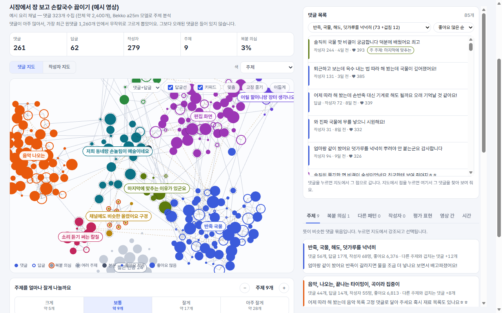
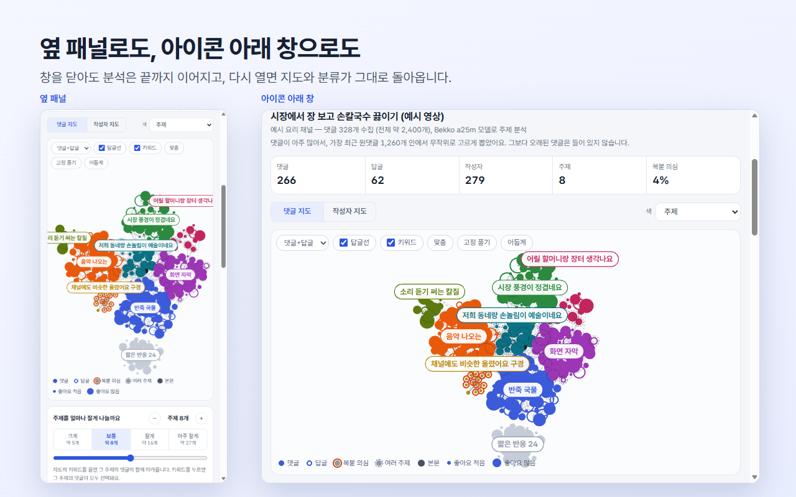
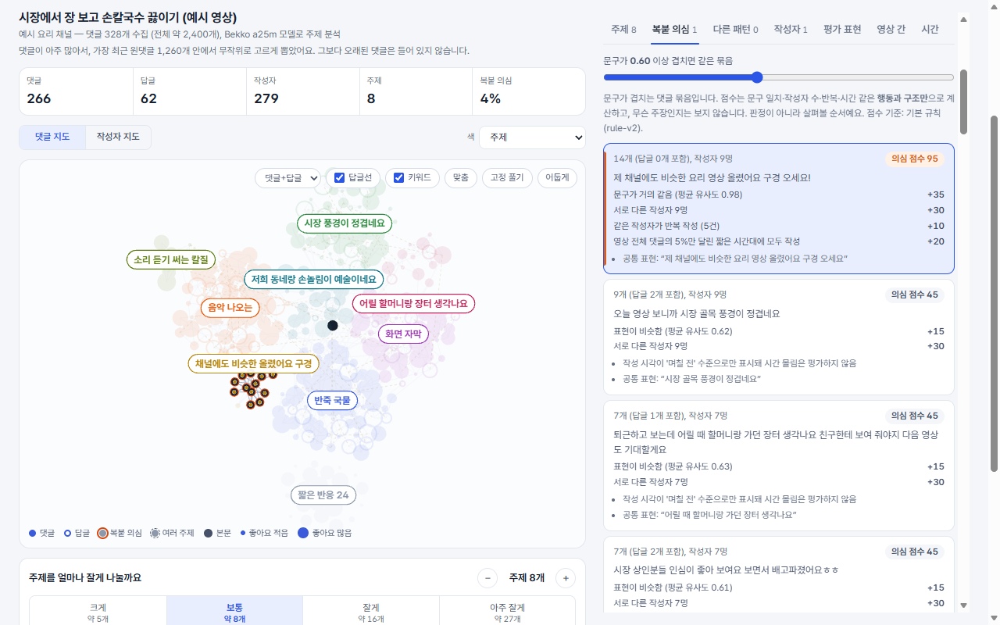

# Web Visualizer

[한국어](README.md) · [English](README.en.md) · **日本語**

YouTube 動画のコメントを**お使いの端末の中で**分析し、似た話題のコメントが集まる**トピックマップ**として表示するブラウザ拡張機能です。
多数のアカウントがほぼ同じ文面を書き込んだまとまりなどの**行動シグナル**を、スコアの根拠とともに示し、自然な反応と見分けやすくします。



- **保存しません**: コメントと分析結果はメモリ上にだけあり、動画のタブを閉じたり、別の動画やサイトに移ったりすると消えます。
- **端末の外に送りません**: 計算はすべてブラウザ内（GPU または CPU）で行います。最初に一度、公開モデルのファイルをダウンロードするだけです。
- **判定はしません**: スコアは行動と構造だけから計算した「確認する順番」です。根拠が足りないときは判断を保留します。
- 現在の対応: YouTube の動画ページ。画面は韓国語です。

## インストール

**Chrome ウェブストア**: （公開後にここへリンクを追加します）

**zip からインストール（現在の方法）**
1. **[web-visualizer.zip をダウンロード](https://github.com/Spruce-tone/web_visualizer/releases/latest/download/web-visualizer.zip)** して展開します
2. アドレスバーに `chrome://extensions`（Edge では `edge://extensions`）と入力し、**デベロッパーモード**をオンにします
3. **パッケージ化されていない拡張機能を読み込む** で、展開した `web-visualizer` フォルダを選びます

ツールバーのパズルアイコンから Web Visualizer を**固定（📌）**しておくと便利です。
更新: zip を再度ダウンロードして同じフォルダに上書きし、拡張機能ページで ↻ を押します。パネルのタイトル横にバージョンが表示されます。

## 使い方

1. YouTube の動画を開き、拡張機能のアイコンをクリックします。
2. **댓글 모아서 분석（コメントを集めて分析）**: スクロールしなくてもコメントと返信を集めます。既定は「均等にランダム」で、高評価の多いコメントばかりに偏りません。
3. 意味分析のモデル（自動選択: Bekko a25m、約 234MB）は初回だけダウンロードします。GPU（WebGPU）があれば GPU で、なければ CPU で計算します。

### サイドパネルまたはアイコンの下のウィンドウ
- 設定の **아이콘을 누르면（アイコンをクリックしたとき）** で、サイドパネルかアイコンの下に開くウィンドウ（ポップアップ）を選べます。選択はブラウザが覚えています。
- ポップアップはページをクリックすると閉じますが、**分析は最後まで続き**、もう一度開くとマップ・分類・基準値がそのまま戻ります。
- **옆 패널로 열기（サイドパネルで開く）** で同じ結果をサイドパネルに移せます。**크게 보기（大きく表示）** は新しいタブでマップと一覧を並べて表示します。



### マップ
- **コメントマップ**: 点 = コメント、線 = 意味の近いコメント同士のつながり、色 = トピック、輪 = 返信、大きさ = 高評価数（その動画内での相対値）、オレンジの縁 = 文面が重なるまとまり、点線の縁 = 複数のトピックにまたがるコメント
- 「ㅋㅋ」や絵文字のような短い反応は、別のまとまりに集めます。
- **キーワードをドラッグ**するとそのトピックが一緒に動き、離した場所にとどまります。キーワードをクリックすると、そのトピックのコメントがすべて選択されます。
- 点をドラッグするとその位置に固定されます（ダブルクリックで解除）。Shift+ドラッグで範囲選択。
- **投稿者マップ**: 点 = 投稿者。行動の似た投稿者同士が集まります。

### コメント一覧と移動
- トピックごとのコメント一覧がマップの横（狭い画面では下）にあります。点をクリックすると一覧で、一覧をクリックするとマップでそのコメントを探します。
- コメントをクリックすると内容が開き、**페이지에서 이 댓글 보기（ページでこのコメントを表示）** で動画を止めずにそのコメントをページの先頭に表示します。
- **自分の分類**: 点を選んで分類ボタン（1〜9）を押すと入ります。

### 結果タブ
- **トピック**: キーワードと代表的なコメント。どれだけ細かく分けるかは、粗く / 普通 / 細かく / とても細かく、またはスライダーで変えられます。
- **コピペの疑い**: スコアと項目ごとの内訳。自然な繰り返しと「判断保留」はスコアなしで別に表示します。
- **その他のパターン**: 同じ主張の言い換え、1 つのコメントに似た返信が集中、同じ時間帯に一緒に書き込んだ投稿者
- **投稿者**: 行動だけから計算したスコアと内訳
- **評価表現**: 非難・称賛の表現の分布（説明用で、スコアには使いません）
- **動画間**: ウィンドウを開いている間に分析した複数の動画に共通して現れた投稿者
- **時間**: 投稿時刻の分布



## 客観性
- スコアは**行動と構造だけ**（文面の重なり、投稿者数、時間の集中など）から計算します。何を主張しているか、誰に向けたものかは見ません。
- あいさつ、短い反応、歌詞の引用のような**自然な繰り返しを先に除きます**。根拠が足りないときはスコアを出さず**判断保留**にします。
- スコアは項目ごとの合計として内訳を示します。対象だけを入れ替えた文が同じスコアになるかを確かめる**入れ替えテスト**を自動で実行しています。
- 結果は「操作だ」という判定ではなく、人が確認する順番です。出身や傾向は推定せず、投稿者名は既定で伏せます。
- 基準の全文（韓国語）: [docs/objectivity.md](docs/objectivity.md) · スコア計算: [docs/signals.md](docs/signals.md) · 検証: [docs/validation.md](docs/validation.md)

## プライバシー
[プライバシーポリシー](docs/privacy.md)（韓国語・英語）。要約: 保存しない、サーバーに送らない（接続先は YouTube と、モデルファイルを取得する Hugging Face のみ）、ブラウザのキャッシュに残るのはモデルファイルだけ、投稿者名は既定で伏せる。

## 分析のしくみ

| 役割 | 方法 |
|---|---|
| 文面の重なりのシグナル | 文字 n-gram ハッシュ（モデル不要、即時） |
| 意味ベクトル | 意味埋め込みモデル（下表）。平均ベクトルを引いてコメント間の差を広げる |
| マップの配置 | UMAP（McInnes ほか, 2018）方式で初期配置し、近傍の線とトピックのまとまりを持つ力学配置で整える |
| トピック分け | 共有近傍（SNN）グラフ（PhenoGraph; Levine ほか, 2015）上のコミュニティ検出（Louvain; Blondel ほか, 2008）。近傍のつながりから補助トピックを最大 2 つ |
| トピックのキーワード | そのトピックを他と分ける単語と 2 語の組（c-TF-IDF 方式 + 超幾何検定） |
| 計算する場所 | 画面のない分析用ドキュメント（offscreen）内の Web Worker。使えない場合はパネル内 |

| 意味モデル | 特徴 |
|---|---|
| 自動（既定） | Bekko a25m。検証用の 30 本の動画で最も速く、トピック名もよく付く |
| Bekko a25m（MIT） | GPU・CPU ともに速い、約 234MB |
| EmbeddingGemma-300M | 英語のコメントが多い動画でやや良い、約 220MB |
| Qwen3-Embedding-0.6B | GPU 推奨、約 580〜630MB |
| 文面のみ | モデルなしで即時。言い回しの違う同じ意味はまとめられない |

## 権限
- `www.youtube.com`: 見ている動画の公開コメントを読み、選んだコメントへ移動する
- `scripting`: 動画のタブにコメント読み取りスクリプトを入れ直す。また「ページでこのコメントを表示」のときにページ側の橋渡しスクリプト（page-bridge）を入れ、コメント欄だけを読み込み直す
- `sidePanel`: サイドパネルで開く
- `offscreen`: ポップアップを閉じても分析を最後まで続ける

## 開発

```bash
git clone https://github.com/Spruce-tone/web_visualizer
cd web_visualizer
npm install --ignore-scripts && npm run vendor   # Transformers.js を vendor/ にコピー（MV3 はリモートコード禁止）
npm test          # 計算ロジック、客観性の基準、パネル・ポップアップ・offscreen の流れ
npm run evaluate  # fixtures/ の検証セットで偏りを確認
```
このフォルダをそのまま「パッケージ化されていない拡張機能」として読み込んで開発できます。
`main` に push すると、GitHub Actions がテスト → バンドル → zip 2 つ（インストール用、ストア提出用）を Releases（`latest-build`）に公開します。

## 制限
- 投稿時刻は「3 日前」のような相対表示から見積もった値です。
- たくさん集めると、YouTube がしばらくリクエストを受け付けないことがあります。その場合は集めた分だけ分析し、その旨を表示します。
- YouTube の画面構成が変わると `content/youtube.js` の修正が必要になることがあります。

フォント: [Pretendard](https://github.com/orioncactus/pretendard)（SIL Open Font License 1.1）。同梱コンポーネント（Transformers.js Apache-2.0、ONNX Runtime Web MIT）のライセンスは zip 内の `vendor/THIRD_PARTY.md` にあります。
