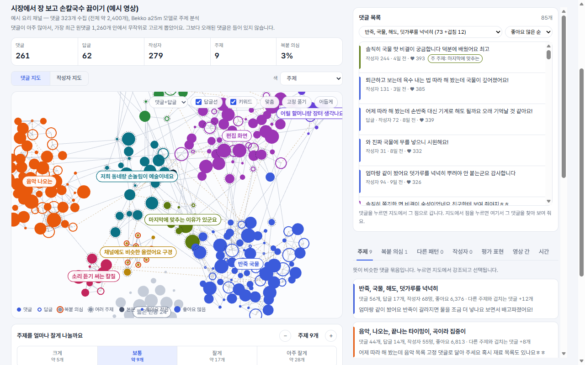
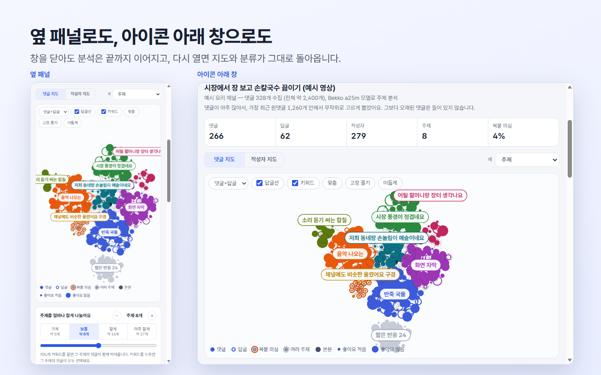
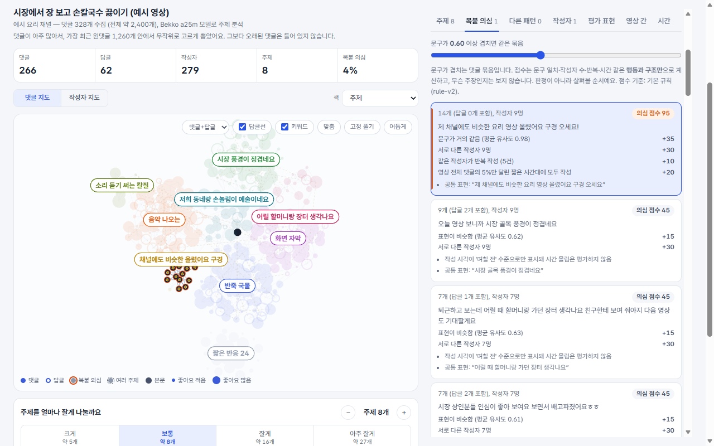

# Web Visualizer

**한국어** · [English](README.en.md) · [日本語](README.ja.md)

YouTube 영상의 댓글을 **기기 안에서** 분석해, 비슷한 이야기끼리 모인 **주제 지도**로 보여 주는 브라우저 확장입니다.
여러 계정이 거의 같은 문구를 쓴 묶음 같은 **행동 신호**를 근거와 함께 보여 주고, 자연스러운 반응과 나눠 볼 수 있게 합니다.



- **저장하지 않음**: 댓글과 분석 결과는 메모리에만 있습니다. 영상 탭을 닫거나 다른 영상·사이트로 가면 사라집니다.
- **기기 밖으로 보내지 않음**: 계산은 모두 브라우저 안(GPU 또는 CPU)에서 합니다. 처음 한 번 공개 모델 파일만 내려받습니다.
- **판정하지 않음**: 점수는 행동·구조만으로 계산한 "살펴볼 순서"입니다. 근거가 부족하면 판단을 보류합니다.
- 지금 지원: YouTube 영상 페이지. 화면은 한국어입니다.

## 설치

**크롬 웹 스토어**: (등록 후 여기에 링크를 넣습니다)

**zip으로 설치 (지금)**
1. **[web-visualizer.zip 다운로드](https://github.com/Spruce-tone/web_visualizer/releases/latest/download/web-visualizer.zip)** → 압축 풀기
2. 주소창에 `chrome://extensions` (Edge는 `edge://extensions`) → **개발자 모드** 켜기
3. **압축해제된 확장 프로그램을 로드** → 풀린 `web-visualizer` 폴더 선택

툴바의 퍼즐 아이콘에서 Web Visualizer를 **고정(📌)** 해 두면 편합니다.
업데이트: zip을 다시 받아 같은 폴더에 덮어쓰기 → 확장 페이지에서 ↻ 새로고침. 패널 제목 옆에 버전이 보입니다.

## 사용

1. YouTube 영상을 열고 확장 아이콘을 누릅니다.
2. **댓글 모아서 분석**: 스크롤하지 않아도 댓글과 답글을 모읍니다. 기본은 '고르게 무작위'라서 좋아요 많은 댓글로만 치우치지 않습니다.
3. 처음 의미 분석을 할 때만 모델(자동 선택: Bekko a25m, 약 234MB)을 내려받습니다. GPU(WebGPU)가 있으면 GPU로, 없으면 CPU로 계산합니다.

### 옆 패널 또는 아이콘 아래 창
- 설정의 **아이콘을 누르면**에서 **옆 패널로 열기** / **아이콘 아래 창으로 열기**를 고릅니다. 고른 값은 브라우저가 기억합니다.
- 아이콘 아래 창은 페이지를 누르면 닫히지만, **분석은 끝까지 이어지고** 다시 열면 지도·분류·기준값이 그대로 돌아옵니다.
- 창 안의 **옆 패널로 열기**로 같은 결과를 옆 패널로 옮길 수 있습니다. **크게 보기**는 새 탭에서 지도와 목록을 나란히 보여 줍니다.



### 지도
- **댓글 지도**: 점 = 댓글, 선 = 뜻이 비슷한 댓글 사이 연결, 색 = 주제, 고리 = 답글, 크기 = 좋아요(그 영상 안에서 상대 크기), 주황 테 = 문구가 겹치는 묶음, 점선 테 = 여러 주제에 걸친 댓글
- "ㅋㅋ", 이모지 같은 짧은 반응은 따로 한 무리로 모읍니다.
- **키워드를 끌면** 그 주제가 함께 움직이고 놓은 자리에 머뭅니다. 키워드를 누르면 그 주제의 댓글이 모두 선택됩니다.
- 점을 끌면 그 자리에 고정됩니다(더블클릭으로 풀기). Shift+드래그로 영역 선택.
- **작성자 지도**: 점 = 작성자, 행동이 비슷한 작성자끼리 모입니다.

### 댓글 목록과 이동
- 주제별 댓글 목록이 지도 옆(좁으면 아래)에 있습니다. 점을 누르면 목록에서, 목록을 누르면 지도에서 그 댓글을 찾아 줍니다.
- 댓글을 누르면 내용이 열리고, **페이지에서 이 댓글 보기**로 영상을 멈추지 않고 그 댓글을 페이지 맨 위에 띄웁니다.
- **내 분류**: 점을 고르고 분류 단추(1~9)를 누르면 담깁니다.

### 결과 탭
- **주제**: 키워드와 대표 댓글. 주제를 얼마나 잘게 나눌지는 크게 / 보통 / 잘게 / 아주 잘게와 슬라이더로 바꿉니다.
- **복붙 의심**: 점수와 항목별 내역. 자연스러운 반복과 '판단 보류'는 점수 없이 따로 표시합니다.
- **다른 패턴**: 같은 주장 다른 표현, 한 댓글에 비슷한 답글이 몰림, 같은 시간대에 함께 쓴 작성자
- **작성자**: 행동만으로 계산한 점수와 내역
- **평가 표현**: 비난·칭찬 표현 분포(설명용, 점수에 쓰지 않음)
- **영상 간**: 창을 연 동안 분석한 영상들에 함께 나타난 작성자
- **시간**: 작성 시각 분포



## 객관성
- 점수는 **행동과 구조만**(문구 겹침, 작성자 수, 시간 몰림 등)으로 계산합니다. 무슨 주장인지, 누구를 향했는지는 보지 않습니다.
- 흔한 인사, 짧은 반응, 가사 인용 같은 **자연스러운 반복은 먼저 거릅니다**. 근거가 부족하면 점수를 내지 않고 **판단 보류**로 둡니다.
- 점수는 항목별 합으로 나눠 보여 줍니다. 대상만 바꾼 문장은 같은 점수가 나와야 한다는 **바꿔 넣기 테스트**를 자동으로 돌립니다.
- 결과는 "조작이다"라는 판정이 아니라 사람이 살펴볼 순서입니다. 출신·성향을 추정하지 않고, 작성자 이름은 기본으로 가립니다.
- 전체 기준: [docs/objectivity.md](docs/objectivity.md) · 점수 계산: [docs/signals.md](docs/signals.md) · 검증: [docs/validation.md](docs/validation.md)

## 개인정보
[개인정보처리방침](docs/privacy.md). 요약: 저장하지 않음, 서버로 보내지 않음(연결하는 곳은 YouTube와 모델 파일을 받는 Hugging Face뿐), 모델 파일만 브라우저 캐시에 남음, 작성자 이름 기본 가림.

## 어떻게 분석하나

| 역할 | 방법 |
|---|---|
| 문구 겹침 신호 | 문자 n-gram 해싱 (모델 없음, 즉시) |
| 뜻 벡터 | 의미 임베딩 모델 (아래). 평균 벡터를 빼서 댓글 사이 차이를 벌림 |
| 지도 배치 | UMAP (McInnes 외, 2018) 방식으로 첫 자리를 잡고, 이웃 선·주제 응집이 있는 힘 배치로 다듬음 |
| 주제 묶기 | 공유 이웃(SNN) 그래프 (PhenoGraph; Levine 외, 2015) 위의 커뮤니티 탐지 (Louvain; Blondel 외, 2008). 이웃 연결로 보조 주제(최대 2개) |
| 주제 키워드 | 낱말과 두 낱말 묶음 중 그 주제를 다른 주제와 가르는 것 (c-TF-IDF 방식 + 초기하 검정) |
| 계산 위치 | 화면 없는 분석 문서(offscreen) 안의 Web Worker. 쓸 수 없으면 패널 안에서 |

| 의미 모델 | 특징 |
|---|---|
| 자동 (기본) | Bekko a25m. 검증 세트 30개 영상에서 가장 빠르고 주제 이름이 잘 붙음 |
| Bekko a25m (MIT) | 빠름(GPU·CPU 모두), 약 234MB |
| EmbeddingGemma-300M | 영어 댓글이 많은 영상에서 조금 나음, 약 220MB |
| Qwen3-Embedding-0.6B | GPU 권장, 약 580~630MB |
| 문구만 | 모델 없이 즉시. 표현이 다른 같은 뜻은 못 묶음 |

## 권한
- `www.youtube.com`: 보고 있는 영상의 공개 댓글 읽기, 고른 댓글로 이동
- `scripting`: 영상 탭에 댓글 읽기 스크립트를 다시 넣기, '페이지에서 이 댓글 보기' 때 페이지 쪽 다리(page-bridge)를 넣어 댓글 영역만 다시 불러오기
- `sidePanel`: 옆 패널로 열기
- `offscreen`: 창을 닫아도 분석이 끝까지 이어지도록

## 개발

```bash
git clone https://github.com/Spruce-tone/web_visualizer
cd web_visualizer
npm install --ignore-scripts && npm run vendor   # Transformers.js를 vendor/로 복사 (MV3는 원격 코드 금지)
npm test          # 계산 로직 + 객관성 기준 + 패널·팝업·offscreen 흐름
npm run evaluate  # fixtures/ 검증 세트로 치우침 점검
```
이 폴더를 바로 "압축해제된 확장 프로그램"으로 로드해 개발할 수 있습니다.
`main`에 push하면 GitHub Actions가 테스트 → 번들 → zip 두 개(설치용, 스토어 제출용)를 Releases(`latest-build`)에 올립니다.

```
manifest.json            MV3 설정
background.js            서비스 워커: 여는 방식(옆 패널/팝업), offscreen 문서 만들기·정리
offscreen/               화면 없는 분석 문서 (탭별 결과를 메모리에)
content/youtube.js       YouTube 어댑터: 댓글 모으기, 댓글 열기
content/page-bridge.js   페이지 쪽 다리: 댓글 영역만 다시 불러와 원하는 댓글을 띄움
lib/pipeline.js          분석 계산 한곳 (worker-core.js, analysis-worker.js가 Worker로 돌림)
lib/offscreen-core.js    offscreen 처리 / job-store.js 탭별 결과 / wire.js 메시지 변환
lib/signals.js 등        신호, 작성자, 패턴, 주제, 지도
sidepanel/               화면 (옆 패널·팝업·'크게 보기' 겸용)
tests/                   run.mjs(계산·객관성·서비스 워커), panel-smoke.mjs(화면 흐름)
docs/                    객관성 기준, 신호, 검증, 개인정보처리방침, 스토어 제출 자료(docs/store/)
```

## 한계
- 작성 시각은 "3일 전" 같은 상대 시간에서 어림한 값입니다.
- 많이 모을수록 YouTube가 요청을 잠시 막을 수 있습니다. 그러면 모은 만큼만 분석하고 알려 줍니다.
- YouTube 화면 구조가 바뀌면 `content/youtube.js`를 고쳐야 할 수 있습니다.

글꼴: [Pretendard](https://github.com/orioncactus/pretendard) (SIL Open Font License 1.1). 함께 배포하는 구성요소(Transformers.js Apache-2.0, ONNX Runtime Web MIT)의 라이선스는 zip 안 `vendor/THIRD_PARTY.md`에 있습니다.
